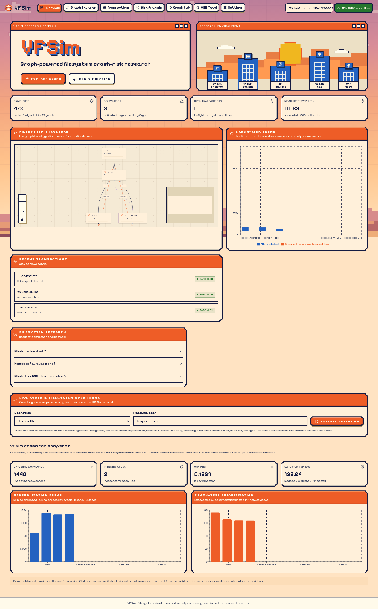

# VFSim — Graph-Based Filesystem Simulator

VFSim is an interactive virtual-filesystem research application. It combines a React pixel-art interface with a Python/FastAPI simulator, graph-based filesystem inspection, trained GNN risk scoring, and FaultLab's **simulated** crash-recovery experiments.

The project is a **research prototype**. The GNN's risk scores are model predictions on simulator-defined workloads, not verified probabilities of failure on a real Linux filesystem. Attention coefficients are internal model signals, not causal explanations. See [research findings](docs/research/INDEPENDENT_MULTISEED_REPORT.md) for scope and limitations.

## Features

- In-memory filesystem operations: create, write, hard link, rename, unlink, and fsync.
- Interactive filesystem graph with inode and directory-entry relationships.
- Transaction history and transaction-specific model predictions.
- Heterogeneous GNN graph, checkpoint and layer selection, attention weights, node features, and embeddings.
- FaultLab simulated recovery outcomes and comparison against saved model baselines.
- Five-seed independent synthetic-workload evaluation with archived checkpoints and results.
- Accessible pixel-art interface with animated tower shortcuts and reduced-motion support.

## Run the demo locally

Use Python 3.10+ and Node.js 22.12+ or 24+. From the repository root, install dependencies and start the FastAPI backend in one terminal.

```bash
python -m pip install -r backend/requirements.txt
python verify_install.py
cd backend
python -m uvicorn main:app --host 127.0.0.1 --port 8000
```

In a second terminal, from the repository root:

```bash
npm ci
npm run dev
```

Open [VFSim](http://127.0.0.1:3000). Under **Live virtual filesystem operations**, create `/report.txt`, write 256 bytes to it, then create a hard link. Open **Graph Explorer** to see the file and link, **Transactions** to inspect the recorded operations, or **Risk Analysis** to see their model scores. State is held in memory and resets when you restart the backend.

See the [setup guide](docs/SETUP.md) for Windows instructions and single-port hosting. The running backend provides [interactive API documentation](http://127.0.0.1:8000/docs).

## Screenshots



[Graph Explorer](docs/screenshots/02_graph_explorer.png) · [Transactions](docs/screenshots/03_transactions.png) · [Crash Lab](docs/screenshots/05_crash_lab.png) · [GNN node inspector](docs/screenshots/08_gnn_selected_node.png) · [Full gallery](docs/SCREENSHOTS.md)

## Architecture

React and TanStack Start render the UI. FastAPI handles filesystem operations and serves graph data, PyTorch inference, and simulated crash results. [Architecture diagram and data flow](docs/ARCHITECTURE.md)

## Verify

```bash
python verify_install.py
(cd backend && python -m pytest -q tests)
npm run verify:frontend
npm run build
```

## Project structure

| Directory or file | Purpose |
| --- | --- |
| `src/routes`, `src/components`, `src/styles.css` | React UI and pixel-art styles |
| `src/services` | API clients and data types |
| `backend/main.py`, `backend/vfs` | FastAPI and virtual filesystem |
| `backend/gnn`, `backend/graph` | Graph construction and model inference |
| `backend/challenging` | FaultLab generation, recovery simulation and evaluation |
| `backend/artifacts` | Model checkpoints, evaluation outputs and recorded metrics |
| `backend/training` | Synthetic training and baseline evaluation tools |
| `backend/legacy_pyg` | **Optional** archived architecture; not imported by the live app |
| `backend/tests`, `src/test` | Backend and frontend regression tests |
| `docs` | Setup, architecture and research documentation |

## Research limitations

The simulator does not replace ext4, mount a kernel filesystem, or reproduce actual power-loss recovery on a storage device. The saved performance numbers are from synthetic workloads generated under the simulator's persistence model. Using VFSim to claim real Linux filesystem crash-risk accuracy would require independent Linux/ext4 validation and documented experimental controls.

## Distribution and acknowledgments

The source archive supplies no project-wide reuse license. Dependencies and fonts retain their own licenses. See [third-party notices](THIRD_PARTY_NOTICES.md).
