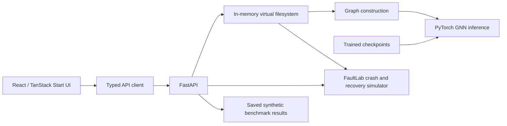

# VFSim architecture

The frontend is a TanStack/React application. `src/services/api.ts` sends requests to the FastAPI server in `backend/main.py`. The server delegates virtual-filesystem operations to `backend/vfs`, graph construction to `backend/graph`, inference to `backend/gnn`, and saved crash-risk experiments to `backend/challenging` and `backend/artifacts`.

A live operation updates the virtual filesystem and records a transaction. The frontend refreshes its queries to display the graph, transaction history, and model scores.

In the research pipeline, synthetic workloads produce modeled crash-recovery outcomes. Graphs and features from those workloads feed model training. The repository includes checkpoints and independent synthetic-workload evaluation results.

The UI supports filesystem topology, transactions, risk analysis, modeled crash tests, checkpoint-specific attention traces, and saved research comparisons. Graph attention indicates learned message weighting; it does not establish causal feature importance.

## Model artifacts

All active checkpoint and evaluation files remain under `backend/artifacts`. The PyTorch Geometric reference model under `backend/legacy_pyg` is archived for optional architectural study and is not a drop-in model with identical prediction labels.

## Further work

A Linux VM with an isolated ext4 test image could support **independent validation** of VFSim's modeled recovery predictions. That would be an additional experimental layer; the existing simulator, trained checkpoints and UI need not move into kernel space.
